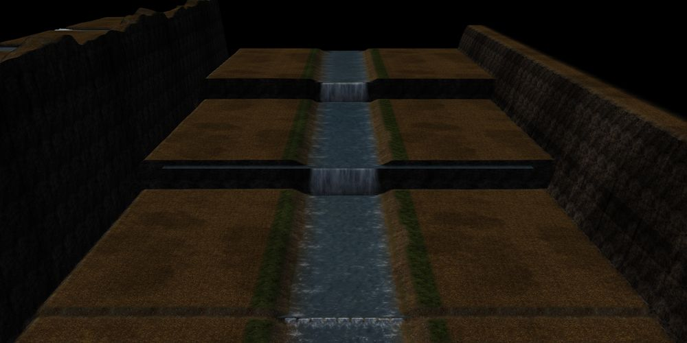
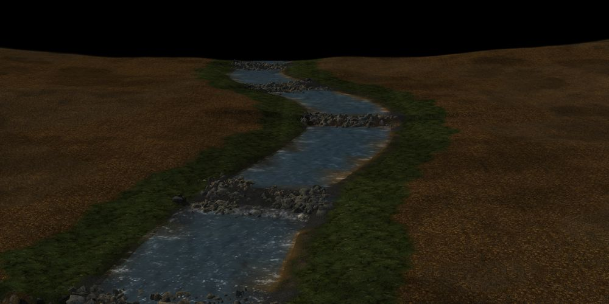
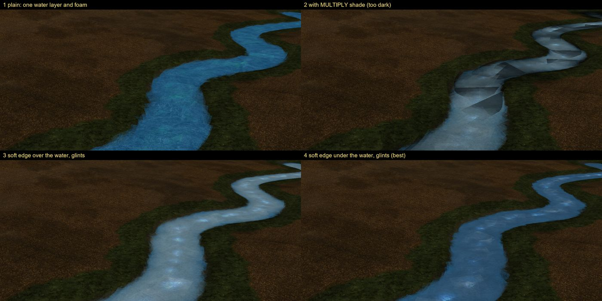
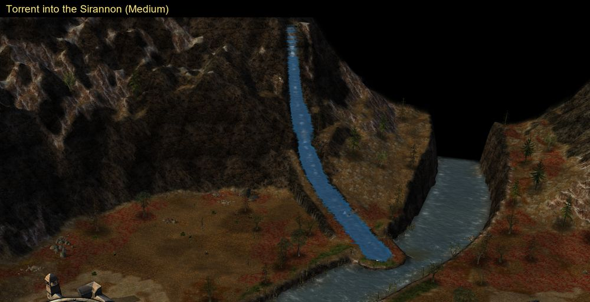

# Water that runs downhill

What a map can do to make water run down a slope in BFME2, measured in the
game (version 1.06, at Medium so water reflections don't mislead) in
October 2026. Every test is on one map, [Water Lab](../../maps/water_lab/map.py),
in three bands: [falls.py](../../maps/water_lab/falls.py) (waterfalls and a stepped river),
[pools.py](../../maps/water_lab/pools.py) (pools and rapids) and [channels.py](../../maps/water_lab/channels.py) (channels down a
slope). Each module's docstring holds its layout and result; `mw build
water-lab` followed by `mw capture water-lab ...` repeats them.

In short, BFME2's water surfaces are flat. Three things make water run
downhill, best first for gameplay:

| Approach | Water Lab | Looks | Units wade in it | Shown by the toolkit's renderer |
|---|---|---|---|---|
| Flat stretches stepping down, with waterfalls at the steps | [falls.py](../../maps/water_lab/falls.py) | a terraced river or a cascade | yes | yes |
| Pools and rapids: flat pools, each ending on a rocky lip | [pools.py](../../maps/water_lab/pools.py) | a mountain stream | yes | yes |
| Particle water along a sloping line | [channels.py](../../maps/water_lab/channels.py) | water running continuously down a slope | no | roughly |

## Water is flat

A standing water area has one height, and so does a river strip
(`RiverAreas`, [rivers](../reference/mapping/terrain-and-presentation/rivers-and-waves.md)).
The game's river drawing takes a height per vertex, but the map stores one per
river: in Water Lab's [channels](../../maps/water_lab/channels.py) a strip over a channel
falling 10% is drawn flat at its height, floating over the low end and
sunk into the high one.

Nothing else lays water along a slope:

- No object setting tilts a model to the ground, and an object's scale is one
  number: a waterfall twice as high is twice as wide.
- Roads lie on the terrain, so a road with a water texture would slope with
  it. In Water Lab's channels no road drew in headless captures, neither a
  map-local `Road` type with a water texture nor the stock `WagonTraveled`,
  and Fords of Isen II looks the same
  with all its road objects removed: its paths are painted terrain. An
  earlier capture shows `DaleRoad01` roads drawn
  ([roads](../reference/mapping/navigation/roads-and-bridges.md)); the
  difference is not explained.
- A map cannot ship its own models: in a test map (since folded into these
  notes), a stock waterfall model copied under a new internal name did not show from
  the map's folder, its `art/w3d`, the runtime's mod folder or loose in the
  game folder.

## Waterfalls

Water Lab ([falls.py](../../maps/water_lab/falls.py)) places every stock waterfall. All draw.

| Template | Fall | Drop at scale 1 |
|---|---|---|
| `RivendellWaterfall02` | one tall curtain, mist at its foot | about 305 |
| `RivendellWaterfall01` | several streams, mist | about 300 |
| `WideWaterfall01`, `WaterfallC01`, `WaterfallC03` | broad, 190 wide | 72 |
| `WaterfallC02`, `WaterfallC04` | narrow, 70 and 40 wide | 72 |

- A fall's origin is its foot, in the lower water; its lip reaches back over
  the upper level. The terrain step must match its drop.
- The Rivendell falls slant back from their foot: stand them out in the pool,
  in front of the cliff, or most of the sheet is inside the rock.
- A fall shows only from downstream.
- Bigger falls are built as the stock maps build them: several side by side
  (`WideWaterfall01` tiles cleanly), or tiers up a cliff (Rivendell stacks
  `WaterfallC02` and `C04` 130 to 190 up), or one fall scaled evenly.

## Rivers in steps

A river descends as a chain of flat stretches, each with its own standing
water and river strip at its own height, as Fords of Isen II does (water 364,
294 and 245, `WideWaterfall01` at the steps). Water Lab has two:

- **Terraces:** two drops of 70, each hidden by falls across the river.
- **Cascade:** eight steps of 8, each a weir of small `WideWaterfall01`
  pieces side by side. It reads best as a river running downhill, but each
  step needs its own water area and strip.



The river in [pools.py](../../maps/water_lab/pools.py) descends as mountain streams do, in
pools and rapids: flat pools that drop 4 to 17 from one to the next, 140 in
all. Each pool ends on a low rocky lip just above its water, across the whole
channel, so its water area and strip end under rock and no straight water edge
shows. Below the lip a gravel rapid with stones and foam falls to the next
pool: long and gentle for a small drop, short and steep with small falls for a
big one. The valley floor and banks fall continuously; only the water steps.
The banks must stand above each pool all the way to its lip: where they dipped
below it, the pool showed as a straight-edged slab.



## Particle water

Particle effects can draw water that slopes. It is visual only: units walk
through it, and its cost (about 5,000 particles for a 3,800-long stream) and
how it looks at Low detail are untested. Like every object, its carriers and
their effects are hidden wherever the player's view is fogged or shrouded
(below). The toolkit's renderer
draws it, but not as the game does: its stream is a pale, narrow band of
sprites along the middle of the channel, where the game's is blue and fills
the channel.

### What a map.ini may define

A map's `map.ini` is read over the game's INI files when the map loads.

- **New particle systems:** an `FXParticleSystem` of a new name loads and works
  ([channels.py](../../maps/water_lab/channels.py)). No stock map does this;
  12 stock maps redefine 137 of the game's own systems each.
- **The game's objects:** may be changed, as the stock maps do (179 `Object`
  blocks in 75 stock `map.ini` files, all of objects the game defines), for
  example `ReplaceModule ModuleTag_Draw` to draw another model.
- **New objects:** an `Object` block adding a type the game doesn't define
  makes the game hang while loading the map. The build lists such
  blocks ([builds](../making-maps.md#builds)). Greywater's vegetation overflow,
  which moves trees to map-local `GW_` objects, crashes while loading; this is
  probably the same cause.
- New `Bridge` types load ([bridges](../reference/mapping/navigation/roads-and-bridges.md)).

### A sloping stream

A particle system's `LineEmissionVolume` has two 3-D end points, so it can emit
along a slope. A stream's course is cut into straight segments of equal
length (160, 80 on steep ground) and fall. At the top of each stands a carrier object turned
down the segment, at the water's height (its z above the ground). The carrier is
a stock object the map doesn't place otherwise, changed in `map.ini` to draw the
invisible haze model with the stream's effects on its bone:

```ini
Object LakeRipple
  ReplaceModule ModuleTag_Draw
    Draw = W3DScriptedModelDraw ModuleTag_DrawMW
      DefaultModelConditionState
        Model = P_WtrflHaze
        ParticleSysBone = HazeBone MWSoftWater
        ParticleSysBone = HazeBone MWSoftEdge
      End
    End
  End
End
```

Each effect emits along the carrier's local +x, from the segment's top to its
foot (`StartPoint = X:-10 Y:0 Z:1.5`, `EndPoint = X:170 Y:0 Z:<1.5 - 180 x
gradient>`), with ground-aligned sprites (`IsGroundAligned = Yes`) that drift
downstream along the slope (`OrthoEmissionVelocity` X 1.0 to 1.6, Z minus
the gradient times that). Because every segment has the same length and fall,
one definition serves the whole stream. The channel is cut along the same
course with its bed just under the water. Each look and gradient needs a
carrier of its own; these stock props work, all alike (one draw module tagged
`ModuleTag_Draw`, no other behaviour or sound): `LakeRipple`, `WtrflHaze`,
`WtrflSteam`, `LakeCoast01` to `03`, `AtmoClouds` and `BigDustCloud`.
(`WaterRippleSpawn02` and `03` are alike too, but the toolkit's renderer
skips them.)

Slopes up to 12% look continuous. At 20% the flat sprites form small steps
and the band breaks up; upright sprites (`IsGroundAligned = No`), which face
the camera, read as white water on steeper slopes.

### Layers and blend modes

One carrier can carry several effects. Each draws over the terrain, the water
and the effects before it, by its `SortLevel`, with its own `Shader`
(the game's particle code, from Open-BFME-2):

| `Shader` | Effect on what lies behind |
|---|---|
| `ALPHA` | ordinary transparency by the texture's alpha |
| `ALPHA_TEST` | hard cut-out |
| `ADDITIVE` | brightens; black parts vanish |
| `MULTIPLY` | darkens; white parts vanish |
| `ADDITIVE_NO_DEPTH_TEST`, `ALPHA_NO_DEPTH_TEST` | as above, over everything |
| `W3D_EMISSIVE`, `W3D_ALPHA`, `W3D_DIFFUSE` | for model particles; sprites draw additive |

Alpha and colour change over a particle's life (up to 8 keyframes each), not
along the stream. A sprite draws one texture: textures cannot be combined,
and `DetailTexture` does nothing with the stock shaders.

Water Lab's channels compare four looks at 6% (and the best at 2, 12 and
20%, and the torrent's at 45%):



1. **Plain:** one layer of river water and foam. The square edges of
   `TWWater01`, which is opaque, show along the banks.
2. **With a `MULTIPLY` shade:** each overlapping sprite darkens again, so the
   stream goes nearly black; a much paler shade still shows hard, shard-like
   edges.
3. **Soft edge over the water:** smooth banks, but pale, milky water.
4. **Soft edge under the water (the best):** `EXWaterPuddle`
   tinted dark blue, wider than the water and under it, gives smooth banks;
   `EXHPWaterTwinkel` with `ADDITIVE` adds glints.

Textures for water particles:

| Texture | Use |
|---|---|
| `TWWater01` | river water; opaque, square edges |
| `EXWaterPuddle` | soft, ragged transparent edge; tinted blue for banks, white for soft foam |
| `EXwaterpuddle2` | white streaks, round: broken water |
| `EXHPWaterTwinkel` | glints on black, for `ADDITIVE` |
| `EXWater01`, `EXWater04` | faint spray and droplets (the stock water effects' own) |
| `EXWaterfallB` | opaque square: upright sprites show as pale shards |
| `PCAWhiteWater` | cyan-green, not white |

### Fog of war

The game hides each object's drawable, its particle effects with it, while
every terrain cell the object covers is fogged or shrouded for the local
player (Open-BFME-2: `GameClientDrawableTOC.cpp`, the client update loop;
`PartitionData::getShroudedStatus`). Water areas and river strips are terrain
and stay visible; particle water disappears. No INI field exempts an object:
the status is the cells' alone, and the one template flag on the way
(`Object::getShroudStatusForPlayer`, template byte 0x10E bit 0x20) forces
fogged, never clear. A map script can reveal the whole map permanently (the
script action that calls `revealMapForPlayerPermanently`, 0x739790), which
ends fog of war for the game; revealing only the ground along a stream is not
checked. `mw play` and `mw capture` reveal the whole map to the local player.

### The Hollin Dales torrent (removed)

A torrent down the Hollin Dales' north mountain face into the Sirannon tested
particle water on a real map, then was taken out of the map.



What worked:

- Water that follows the mountain: the face is steep at the top and gentle
  at its foot, so each 80-long segment took one of three gradients (1.0, 0.5,
  0.22), the one keeping its water nearest 12 under the face, each gradient
  with its own effects and carrier. One gradient for the whole torrent left
  its lower half floating up to 90 above the ground.
- A slight crevasse: a gully about 50 wide with steep rock walls, its bed
  deeper under the steep segments, low banks raised where the face lay below
  the water, and scattered vegetation kept out of it.
- The soft look above, smaller flat sprites on steeper segments, and upright
  `EXWaterPuddle` tinted white for white water, more of it the steeper the
  fall.
- Running the course on into the river, not stopping at the top of its bank.

What didn't:

- At 45% and steeper the flat sprites still show as horizontal bands.
- Upright `EXWaterfallB` showed as pale squares.
- From a distance the torrent reads as a pale streak, much bluer than the
  river, and units walk through it.
